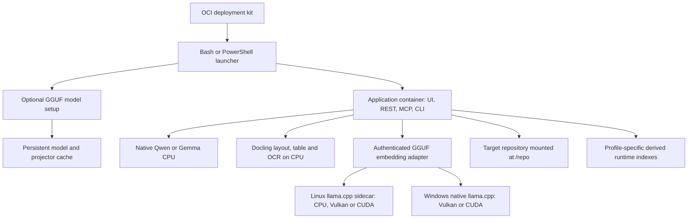

# Portable production deployment

The production image is Linux amd64. Windows runs it through Docker Desktop
with WSL2/Linux containers. The default uses native Qwen CPU inference; Gemma
CPU is selectable. The diagnostic core image remains dependency-light and uses
hashing rather than semantic model inference.

## Setup and data ownership

The kit defaults the target to its parent directory, preserves existing export
files, and provides product-only Make targets. Model setup obtains the pinned
selected weights and Docling assets before retrieval readiness. Gemma GGUF also
requires its projector. Native CPU models and document assets persist in the
model volume; Windows GPU assets persist in the kit's accelerator directory.
The target owns canonical knowledge and derived `.project-intelligence-cache/`;
the application image does not own the user's project. Model cache storage is
separate from profile-specific vector namespaces.

UI, MCP and CLI share production retrieval composition. Environment overrides
are resolved before source fingerprinting and recorded with readiness, so
switching models cannot retain a misleading previous-model status. Gemma
embeds repository images and extracted PDF figures; Qwen is the text path.
Audio/video ingestion is not exposed.

## Failure, recovery and security

Liveness can succeed while setup/indexing is pending; launchers require retrieval
readiness. Missing credentials, invalid downloads, unavailable GPU devices and
model failures must be diagnosed rather than silently changing the selected
backend. GGUF files are hash-checked and downloads are installed atomically.
Stop services before changing backend; restarting reuses downloaded assets.
PyTorch/GGUF identities isolate incompatible vectors. Native generation recovery
and branch reconciliation rebuild disposable indexes from authoritative inputs.

The UI binds to loopback by default. GGUF HTTP uses a local bearer key and checks
model identity. On Windows restrict native service access to Docker/WSL in the
firewall. Credentials are runtime inputs, never kit/image content. Materialising
canonical data continues to require operator approval. Exact dependency review
acceptance is invalidated by changed lock, inventory or evidence hashes.

## Delivery and validation

The GitHub workflow verifies pull requests without publishing. Pushes to dev,
development and main build and test production, publish a commit-tagged image,
then publish the matching digest-bound kit and promote branch aliases. No
automatic expiry is configured; registry owners can still delete artifacts.

Local validation covers real CPU model search, Gemma image sensitivity, Docling
OCR, container startup/restart, kit export and backend configuration. Physical
Vulkan/CUDA and Windows runs and remote publication remain unverified. Follow
[installation](../../../docs/PRODUCTION_INSTALL.md),
[kit operation](../../../distribution/deployment/README.md), and the
[verification report](../../../docs/PRODUCTION_RECONCILIATION_STATUS.md).
The full portability change stays active until those acceptance checks finish.
