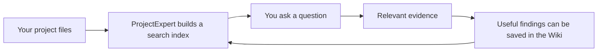

# ProjectExpert

**Understand a project without reading every file.** ProjectExpert searches your
project's code and documents so you and your coding assistant can find relevant
information and its sources.

You can ask where a feature is implemented, find a requirement, or investigate
a library your project uses. ProjectExpert works with Java, Python, and
JavaScript/Node.js projects, with [some limits](docs/DEPENDENCY_RESEARCH.md).

**New here?** Follow [Start with Docker](#start-with-docker), then [ask your
first question](#ask-your-first-question). Already installed? See [everyday
commands](#everyday-commands).

## Start with Docker

You need Docker Desktop or Docker Engine with Compose, an internet connection,
GNU Make, and enough disk space for the application and its model. Start Docker first.
The first startup downloads files and can take a while.

Open a terminal in the folder of the project **you want to understand**. For
example, if your project is in `~/projects/my-app`, enter:

```bash
cd ~/projects/my-app
```

Replace that path with your own. Run the next two commands in that same folder.

**1. Set up ProjectExpert**

This runs a short-lived container from the OCI registry. It copies the deployment
kit, including the Makefile and Docker Compose files, into
`.project-intelligence-deploy/` inside your project, then exits. You only need
to do this once for that project.

```bash
docker run --pull=always --rm -v "$PWD:/deployment" ghcr.io/shkirmantsev/project-intelligence-deployment:dev
```

**2. Start ProjectExpert**

```bash
make -C .project-intelligence-deploy platform-start
```

Make calls the kit's Compose helper, which selects the runtime profile and
starts the ProjectExpert services with Docker Compose. If Make is unavailable,
run `bash .project-intelligence-deploy/start.sh` instead.

Wait for a message beginning with `Ready:`. Open the address shown there,
usually **[http://localhost:8765/](http://localhost:8765/)**. Keep Docker
running while you use ProjectExpert. The browser page may still be preparing
its search index after the service starts; check
[readiness](http://localhost:8765/health/ready) if your question cannot yet
be answered.

The `:dev` image is a development version. Setup preserves an existing kit and
its image pins; to update an existing installation, follow the
[upgrade instructions](docs/PRODUCTION_INSTALL.md). If startup fails, see
[troubleshooting](docs/TROUBLESHOOTING.md). See the [installation guide](docs/PRODUCTION_INSTALL.md) for the tested
platform matrix and release status.

<details>
<summary>Using Windows PowerShell?</summary>

Open PowerShell in your project folder. With Docker Desktop running in WSL2
and Linux container mode, use these commands:

```powershell
docker run --pull=always --rm -v "${PWD}:/deployment" ghcr.io/shkirmantsev/project-intelligence-deployment:dev
& .\.project-intelligence-deploy\start.ps1
```

Windows must allow local PowerShell scripts. See the
[deployment kit guide](distribution/deployment/README.md) for its platform
limits and stop instructions.

</details>

## Ask your first question

1. Open the `Ready:` address in your browser.
2. Find **1. Ask a project question**. Type a question and select **Ask**.
3. Read the result and check the referenced project evidence. If the page is
   still preparing, wait and try again.

For example, ask **“Where is order validation implemented?”** Replace “order
validation” with a feature in your project. You can also select **List sources**
on the page to see what ProjectExpert found.

| Your goal | Try asking |
|---|---|
| Find where a feature lives | “Where is customer sign-in implemented?” |
| Understand a change | “Which requirements describe the payment flow?” |
| Prepare for a bug fix | “Where is an invalid order rejected?” |
| Investigate a library | Ask a connected coding assistant: “Which version of this library does the project use, and where is it declared?” |

Results depend on the files available and the selected interface and model.
A result can contain retrieved evidence rather than a complete conversational
answer. Check the cited material and ask a more specific question if needed.
For deeper library research and examples, see
[dependency research](docs/DEPENDENCY_RESEARCH.md).

## Everyday commands

Run these from the same project folder. These commands need GNU Make; the
[kit guide](distribution/deployment/README.md) also describes script-based
alternatives and Windows commands.

| I want to… | Command |
|---|---|
| See available commands and descriptions | `make -C .project-intelligence-deploy` |
| Start again | `make -C .project-intelligence-deploy platform-start` |
| Check whether it is ready | `make -C .project-intelligence-deploy platform-status` |
| See startup messages | `make -C .project-intelligence-deploy platform-logs` |
| Refresh the search index after project changes | `make -C .project-intelligence-deploy platform-hydrate` |
| Stop ProjectExpert | `make -C .project-intelligence-deploy platform-stop` |

Press `Ctrl+C` to leave the live log view. Stopping keeps your downloaded model
cache. To stop without Make, run `bash .project-intelligence-deploy/compose.sh down`.

## Choose how to use it

| I want to… | Where to go |
|---|---|
| Ask a question in a browser | Open [http://localhost:8765/](http://localhost:8765/) after startup. |
| Give a coding assistant project context | Connect an MCP-compatible assistant to `http://localhost:8765/mcp`. See [MCP setup](docs/USER_GUIDE.md#mcp-for-coding-assistants). |
| Use another chat application | Install it separately and configure the optional Open WebUI compatibility route. See [chat frontends](docs/USER_GUIDE.md#open-webui-and-other-chat-frontends). |
| Connect software or another agent | See the [REST and A2A interfaces](docs/USER_GUIDE.md#choose-an-interface). |

These addresses use the default port. If you change `PI_CONTROL_PORT`, use the
new port instead. Access and authentication settings are explained in the
[user guide](docs/USER_GUIDE.md).

## How it works



ProjectExpert reads your project and builds a searchable index. It uses that
index to find evidence for your questions. A coding assistant can save reviewed
findings in the project Wiki; a later refresh makes them searchable. The
[architecture guide](docs/ARCHITECTURE.md) explains the full process and where
the data is stored.

## Configuration

### Do I need to set environment variables?

Short answer: **no.** The deployment kit ships a `deployment.env` file with
working defaults, so `make platform-start` works on a clean installation
without touching your shell at all. You only need environment variables if you
want to override a default for one run.

It helps to keep two things apart:

- **Settings** live in `.project-intelligence-deploy/deployment.env` inside your
  project. It is a plain text file that the kit reads; it is never executed as
  shell code.
- **Environment variables** are optional overrides. A variable exported in your
  shell wins over the file, and the file wins over the built-in default.

### Settings you may want to change

Edit `.project-intelligence-deploy/deployment.env` in your project, or export the
same name in your shell for a single run:

| Setting | Default | What it does |
|---|---|---|
| `PI_TARGET_REPO` | `..` | Which folder gets analysed. The kit sits in `.project-intelligence-deploy/`, so `..` is your project root. Use forward slashes on Windows. |
| `PI_CONTROL_PORT` | `8765` | The port you open in the browser. |
| `PI_BIND_HOST` | `127.0.0.1` | The interface the service listens on. Keep it on loopback unless you really mean to expose it. |
| `PI_EMBEDDING_MODEL` | `gemma` | `gemma` (the default; the model is downloaded on first start) or `gemma-torch` (native PyTorch, text and image only). |
| `PI_ACCELERATOR` | `auto` | `auto`, `cpu`, `vulkan` or `cuda`. `auto` picks the fastest backend it can prove works, and falls back to CPU when the GPU is missing, unusable or slower. |
| `PI_GPU_DEVICE` | auto-detected | Pins one device, for example `Vulkan1`. It is honoured only when the runtime actually reports that device. |
| `PI_DOCLING_ENABLED` | `1` | PDF, table and OCR parsing. Set it to `0` to skip that work. |
| `PI_IMAGE` | published production image | Pins the application image. Change it only when you upgrade deliberately. |

Stop and start the service after changing the port or the model.

The only setting that can be a secret is `HF_TOKEN`, and you need it only when
you select a gated Hugging Face model. Export it in your shell rather than
writing it into the kit:

```bash
export HF_TOKEN=hf_...
```

Keep secrets out of `deployment.env`: it lives in your project folder and can
end up in Git.

See the [deployment kit guide](distribution/deployment/README.md) for the full
list of settings, the model and accelerator details, and the upgrade steps.

Working on ProjectExpert itself rather than using it? The repository has its
own `.env` for the development harness; see
[configuration](docs/CONFIGURATION.md).

## No Docker? Use Python

This alternative requires a **ProjectExpert source checkout** and Python 3.11
or newer. The locked requirements below target Python 3.11 on Linux x86_64. Run them in the ProjectExpert
checkout, not in the project you want to analyze:

```bash
python3 -m venv .venv
.venv/bin/python -m pip install --require-hashes -r requirements-production-linux-x86_64.txt -r requirements-production-java-linux-x86_64.txt
.venv/bin/python -m pip install --no-deps '.[production]'
.venv/bin/python -m pip check
```

Then replace `/absolute/path/to/your-project` with the full path to your project:

```bash
.venv/bin/python -m pi_platform.cli start --target /absolute/path/to/your-project --model gemma-torch --device cpu --serve
```

Open [http://localhost:8765/](http://localhost:8765/). This process runs in the
terminal; press `Ctrl+C` to stop it. For other systems and installation limits,
see [install and launch](docs/PRODUCTION_INSTALL.md).

In this mode the settings above are command-line flags (`--target`, `--model`,
`--device`, `--port`), so no environment variables are needed either. The
embedding model is downloaded into your local Hugging Face cache; set
`HF_HOME` if you want it somewhere else.

## More help

- [User guide](docs/USER_GUIDE.md): interfaces, examples, and detailed capability limits.
- [Dependency research](docs/DEPENDENCY_RESEARCH.md): supported languages, library code, and Wiki reuse.
- [Architecture](docs/ARCHITECTURE.md): the components, question flow, and data lifecycle.
- [Troubleshooting](docs/TROUBLESHOOTING.md): startup, readiness, and missing evidence.
- [Documentation map](docs/README.md): all project documentation and contributor guides.
