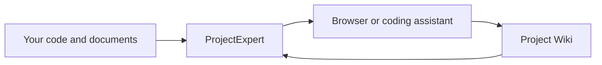

# ProjectExpert

## What it is

ProjectExpert helps you understand a codebase and the libraries it uses. Run it
beside your project, then ask questions in the browser or connect your coding
assistant. Useful findings can be saved in a project Wiki for the next session.

A *dependency* is a library your project uses.



Text alternative: ProjectExpert reads your project, supplies context to people
and agents, and reuses curated Wiki explanations.

## Start with Docker

You need Docker with Compose, GHCR registry access and disk space for images
and model assets — no host Python or GNU Make. The tested platform matrix and
the first-start download expectation are in the
[installation guide](docs/PRODUCTION_INSTALL.md).

Run both commands **from the project you want to analyze**, not a checkout.

**1. Set up** — exports the deployment kit into this project:

```bash
docker run --pull=always --rm -v "$PWD:/deployment" ghcr.io/shkirmantsev/project-intelligence-deployment:dev
```

**2. Run** — starts the service and prepares its model:

```bash
bash .project-intelligence-deploy/start.sh
```

Then open `http://localhost:8765/` (or your configured port). The first start
downloads model assets and builds the index, so it is much slower than later
starts; the launcher prints `Ready: http://localhost:8765` when the service is
up. If the page still says it is preparing data, check
`http://localhost:8765/health/ready` — `/health` only proves the process is
alive, `/health/ready` proves the index is usable. If the registry keeps asking
for credentials, sign in once with `docker login ghcr`. When startup fails,
start with [troubleshooting](docs/TROUBLESHOOTING.md).

Stop the deployment (this keeps the downloaded model cache):

```bash
make -C .project-intelligence-deploy platform-stop
```

Without GNU Make, stop it with `bash .project-intelligence-deploy/compose.sh down`.
Windows uses the kit's `stop.ps1`.

Two cautions. The `:dev` tag is a development channel, not a stable release.
Exporting a kit **preserves** your existing files and image pins, so fetching a
newer kit alone does not upgrade an existing installation; follow the
[upgrade steps](docs/PRODUCTION_INSTALL.md) instead.

<details>
<summary>Windows PowerShell</summary>

```powershell
docker run --pull=always --rm -v "${PWD}:/deployment" ghcr.io/shkirmantsev/project-intelligence-deployment:dev
& .\.project-intelligence-deploy\start.ps1
```

The execution policy must permit local scripts, and Windows uses Docker Desktop
with WSL2 and Linux containers. This path is **NOT RUN** in the current
verification environment; the [kit guide](distribution/deployment/README.md)
marks which configurations are verified and which are conditional.

</details>

## No Docker? Use Python

From a ProjectExpert source checkout, with Python 3.11 or newer:

```bash
python3 -m venv .venv
.venv/bin/python -m pip install --require-hashes -r requirements-production-linux-x86_64.txt -r requirements-production-java-linux-x86_64.txt
.venv/bin/python -m pip install --no-deps '.[production]'
.venv/bin/python -m pip check
```

Start it against your project — the analyzed repository is passed separately:

```bash
.venv/bin/python -m pi_platform.cli start --target /absolute/path/to/your-project --model gemma-torch --device cpu --serve
```

The server runs in the foreground; stop it with `Ctrl+C`. The hash-locked
requirements cover Linux x86_64 only; other hosts use the less strictly locked
fallback, with its verification duties, in the
[full installation guide](docs/PRODUCTION_INSTALL.md). This path does not
depend on the optional harness integrations.

## What can I do?

Every answer cites the evidence it came from, so you can check a claim instead
of trusting it. Start with one concrete question about your own project:

| What I want | How I use it | Example |
|---|---|---|
| Understand an unfamiliar project | Built-in web UI | “Where is order validation implemented?” |
| Give a coding assistant project context | MCP client connected to ProjectExpert | Search requirements, source and curated explanations |
| Investigate a library | Dependency research tools | “Why is this version used, and what does this method do?” |
| Reuse an explanation next time | Wiki tools | Add a cited finding to the existing topic page |
| Use a separate chat frontend | Optional Open WebUI integration — a compatibility route, not a bundled frontend | Configure its backend against the enabled compatibility route |
| Request research from another agent | Optional A2A | Send the documented dependency task envelope |

Practical first queries, interface setup and authentication are in the
[user guide](docs/USER_GUIDE.md).

## Connect your tools

Every surface below shares the product port (`PI_CONTROL_PORT`, default `8765`).
Pick the row that matches how you want to work:

| Surface | Address/port | Conditions |
|---|---|---|
| Built-in HTML UI | `http://localhost:8765/` | Default interface; honor `PI_CONTROL_PORT` |
| REST API | `http://localhost:8765/api/v1/` | Query, retrieve, graph, wiki, status and materialisation routes; an operator-configured bearer token is required when one is set |
| MCP over Streamable HTTP | `http://localhost:8765/mcp` | POST only (GET returns 405); initialize and `tools/list` use POST. This is **not** the harness project-context MCP |
| Health | `/health` and `/health/ready` on the product port | Live process versus usable index |
| Embedded A2A | `/a2a/v1/tasks:send` and `/.well-known/agent-card.json` on the product port | Only when `PI_A2A_INBOUND` is `1`, `true`, `yes` or `on` |
| Standalone A2A | `python3 -m pi_platform.cli a2a-serve`, default port 8766 | Separate optional process; pass `--target` at the project directory; not needed alongside embedded A2A |
| Open WebUI compatibility | `POST /v1/chat/completions` on the product port | Controlled by `PI_OPEN_WEBUI_ADAPTER`; a compatibility route only — the frontend is installed separately, and no service listens on 8767 |
| Embedding service | Internal service port 8769 | Internal only; not a browser or chat interface |

From another container, `localhost` means that container, not your host. The
[user guide](docs/USER_GUIDE.md) explains each surface, its enabling condition
and how clients connect.

## Capabilities and limits

| Area | Current support and limits |
|---|---|
| Java (Maven/Gradle) | Declared dependencies are read from `pom.xml` / `build.gradle`. The transitive closure is **not** resolved automatically, because a dependency-tree command executes project code; an explicitly selected local Maven repository supplies installed versions. |
| Python | `uv.lock` (lockfile version 1) and `poetry.lock` (lock versions 1.1, 2.0, 2.1) are read; `pyproject.toml` and `requirements*.txt` give the declared constraints; an explicitly selected environment's dist-info metadata gives installed versions. A declaration is never reported as a resolution. |
| Node/JavaScript/TypeScript | `package.json`, `package-lock.json` (npm lockfile versions 1, 2, 3), `pnpm-lock.yaml` (lockfile versions 6.0 and 9.0) and `yarn.lock` (Yarn classic v1 and Yarn berry lockfile v2–v8) are read. Source symbols come from the tree-sitter JavaScript/TypeScript grammars, which are **optional**: without them the Node source evidence is partial and the capability report says so. |
| Dependency research tools over MCP | `project.dependency_tree`, `project.dependency_search`, `project.dependency_read`, `project.dependency_acquire`. `project.get_dependency` keeps its original Maven argument shape (group, artifact, version) and answers from the real dependency graph. |
| Over A2A | The same research is available through a versioned envelope `{"schema_version":1,"operation":"dependency.tree","arguments":{...}}` with the allowlisted operations `dependency.tree`, `dependency.search`, `dependency.read`, `dependency.acquire`. An unknown operation is rejected; it never succeeds as an acknowledgement. |
| Artifact acquisition | Downloads an exact name+version from an **approved source only**, verifies the digest, refuses a redirect that leaves the approved hosts, and never runs package code. It is disabled unless the operator names approved sources (`PI_RESEARCH_SOURCES`, comma separated, e.g. `pypi,npm,maven-central`). |
| Reconstructed code | A disassembly is not recovered source and is labelled as such; a decompilation is a reconstruction. No decompiler is bundled. Native binaries are never decompiled. |
| Curated Wiki | `project.wiki_search`, `project.wiki_read_page`, `project.wiki_write_page`, `project.wiki_validate`. A write presents the revision it read (`expected_revision`); a changed page yields a conflict instead of an overwrite. A page becomes part of the searchable corpus on the next project refresh. |

Language-by-language examples, provenance and Wiki reuse are in
[dependency research](docs/DEPENDENCY_RESEARCH.md).

## Configuration

Container users edit `.project-intelligence-deploy/deployment.env` inside the
exported kit. Shell environment variables override that file, and changing the
port requires a stop and start.

| Setting | Default | Effect |
|---|---|---|
| `PI_CONTROL_PORT` | `8765` | The product port; a restart is required |
| `PI_TARGET_REPO` | `..` | The repository that is mounted and analyzed |
| `PI_ACCELERATOR` | `auto` | `auto` / `cpu` / `vulkan` / `cuda`; a GPU is an optimisation and degrades to the validated CPU profile |
| `PI_EMBEDDING_MODEL` | `gemma` | `gemma` (pinned EmbeddingGemma 2 Q8_0 through the managed llama.cpp runtime) or `gemma-torch` (native binding, text and image only) |
| `PI_BIND_HOST` | `127.0.0.1` | Interface the product port is published on |

The [configuration reference](docs/CONFIGURATION.md) covers settings precedence
and client configuration, and the [kit guide](distribution/deployment/README.md)
covers model, hardware and maintenance commands. Never put credentials or
tokens in these files.

Your analyzed project holds the data: `project-knowledge/` is the readable,
versioned knowledge tree, while `.project-intelligence-cache/` is a derived
index that can be rebuilt. Stopping the deployment keeps both, together with
the model cache volume.

## Learn more

- [Architecture](docs/ARCHITECTURE.md) — big picture, user workflow and data process.
- [Dependency research](docs/DEPENDENCY_RESEARCH.md) — language support, source limits, examples and Wiki reuse.
- [User guide](docs/USER_GUIDE.md) — use cases, interfaces, ports, authentication and first queries.
- [Installation and upgrades](docs/PRODUCTION_INSTALL.md) — prerequisites, platform matrix, model assets, rollback.
- [Deployment kit reference](distribution/deployment/README.md) — exported kit commands and operations.
- [Configuration](docs/CONFIGURATION.md) — settings, defaults and precedence.
- [Troubleshooting](docs/TROUBLESHOOTING.md) — readiness, ports and missing evidence.
- [Documentation map](docs/README.md) — contributor and harness material.