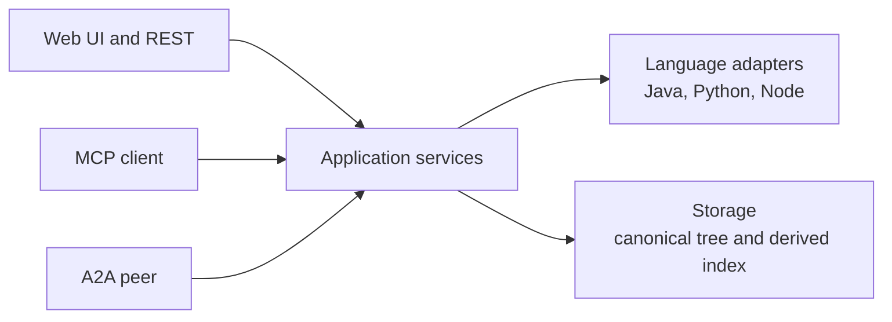
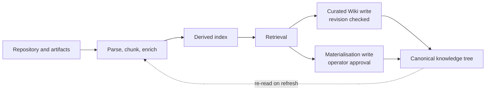

# Architecture

[Project home](../README.md) · [User guide](USER_GUIDE.md) ·
[Dependency research](DEPENDENCY_RESEARCH.md)

This page explains the system in three pictures: how the pieces are layered,
how one question is answered, and how repository content becomes searchable
knowledge. Each diagram has a prose equivalent, so nothing depends on a
renderer that understands Mermaid.

## Interfaces, services and adapters

**Text alternative:** Browser and REST users, MCP clients and A2A peers all
talk to the same application services. Those services delegate language-specific
work — manifests, lock files, library sources — to language adapters, and
persist results through the storage layer.

Everything outside the product speaks one of four interfaces: the built-in web
UI and REST API on the product port, MCP over Streamable HTTP on the same
port, an optional embedded or standalone A2A surface, and an optional
OpenAI-compatible route for external chat frontends. The application services
behind them own querying, retrieval, dependency research, Wiki curation,
readiness and approval. Language adapters know how to read a `pom.xml`, a lock
file or a package manifest; storage knows where canonical and derived data
live. The interface never reaches into a language adapter directly.

## How a question is answered

**Text alternative:** A question first consults what the project already knows.
If that is not enough, missing evidence is inspected — source files, lock
files, library artifacts — and the answer comes back with citations. A verified
finding is then curated into the Wiki, where the next refresh makes it
available to the next retrieval.

Retrieval-first is the rule: existing knowledge — requirements, specs,
architecture notes, previously curated Wiki pages — is consulted before any
broad scan of the source tree. When the existing knowledge does not cover the
question, the missing evidence is inspected with bounded reads (source
excerpts, dependency inspection, approved artifact acquisition) rather than
unbounded exploration. The answer carries the evidence it rests on, so a reader
can verify a claim. What is worth keeping is written back to the curated Wiki
with the revision it was based on; a page that changed in the meantime
produces a conflict instead of a silent overwrite.

## From repository to index, and the two write paths

**Text alternative:** The analyzed repository and any approved artifacts are
parsed, chunked and enriched, which produces a derived index that retrieval
reads. Two separate write paths leave the retrieval/answer stage: curated Wiki
pages are written with a revision precondition, and materialised changes are
written into the canonical knowledge tree only after operator approval. Both
end up in the canonical tree, which the next refresh reads again.

Parsing, chunking and enrichment turn source files, documents and manifests
into indexed evidence. That index is derived: it can always be rebuilt from
the repository. Retrieval reads it to answer questions. Curation and
materialisation are deliberately different operations — curation saves an
explanation with its revision check, while materialisation writes reviewed
runtime changes back into the repository and needs an operator approval step.
Nothing writes into the canonical tree silently.

## Canonical and disposable data

Plainly: **canonical data is the copy you would keep if everything else were
deleted; disposable data is a cache that can be rebuilt.**

- `project-knowledge/` in the analyzed repository is canonical. It is readable,
  versioned and human-browsable, and it holds source-derived knowledge,
  requirements, decisions and the curated Wiki (including the
  `project-knowledge/wiki/` pages written by research sessions).
- `.project-intelligence-cache/` is disposable. It holds the derived index,
  embeddings and working state, and a refresh rebuilds it from the repository.
- The runtime model cache (a named volume in the container deployment) is also
  disposable: it holds downloaded model assets and can be re-fetched.

Reads come from the derived index; the only writes into canonical data are the
curated Wiki write (revision checked) and materialisation (operator approval),
shown separately in the diagram above.

## Related pages

- [README](../README.md) — quick start, capabilities and limits.
- [User guide](USER_GUIDE.md) — interfaces, ports and first queries.
- [Dependency research](DEPENDENCY_RESEARCH.md) — ecosystem support and provenance.
- [Configuration](CONFIGURATION.md) — settings and precedence.
- [Production install](PRODUCTION_INSTALL.md) — platform matrix and upgrades.
- [Deployment kit reference](../distribution/deployment/README.md) — exported kit operations.
- [Documentation map](README.md) — contributor and harness material.