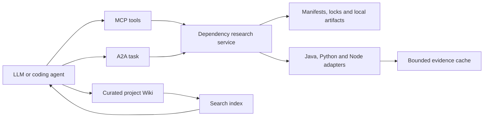
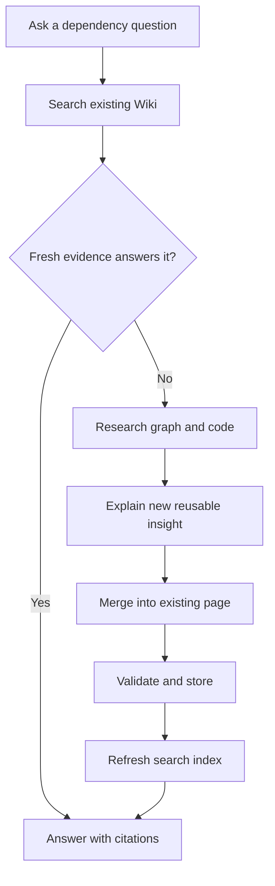

# Design

## Current state

See [evidence](evidence.md) for inspected paths and uncertainties. Reuse static Python ingestion, Java adapters, the existing tool context factory, A2A transport, and the OKF Wiki writer. This design adds a shared application service, not a second ingestion/indexing platform.

## Proposed design

### 1. Deployment help and Compose consistency

Set the kit Makefile default to `help`; add concise `##` target descriptions and a help implementation that needs only Make and the platform shell. Keep platform-start explicit. List potentially mutating operations clearly. Test the exported kit, not only the source Makefile.

Reproduce the warning on a disposable deployment that already has embeddings/model-setup. Record each Compose file set and project identity. Preferred fix: assemble the complete applicable topology for helper invocations as well as final startup. Inference planning can use a provisional CPU overlay before selection; it runs only production with `--no-deps`. Candidate probes use their candidate overlay. Apply the same construction in PowerShell. Do not introduce a separate project/network for helpers that must reach `embeddings` without deliberately arranging connectivity.

Do not suppress all orphan warnings or run `--remove-orphans`: the logged containers belong to the intended deployment. Test genuine unrelated services separately. Preserve one-shot model-setup exit handling. Resolve displayed URL from the same effective environment/Compose configuration used to start production; never source deployment.env as executable shell code. Test shell overrides, env-file values, spaces in paths, missing config, and failed health checks.

### 2. Shared dependency research service

Add a narrow language-neutral research port and application service, with Python, Java and Node adapters. Place domain records and traversal under `pi_platform/core/`, adapter parsing/acquisition under `pi_platform/adapters/`, and the port under `pi_platform/ports/`. Choose exact filenames in implementation and record them here. Compose once in `pi_platform/mcp/context.py` / production composition and inject the same service into A2A. Transport handlers validate/translate; they must not implement independent resolvers.

Both protocols call one service. It reads dependency evidence and returns bounded results. The caller explains useful findings in the target Wiki; normal indexing makes those explanations reusable.

Proposed record contract:

| Record | Required fields and meaning |
|---|---|
| Package | ecosystem, normalized name, declared constraint, optional resolved version, scope, source kind, environment; null resolved version means unknown |
| Instance | package identity plus lock location/workspace/peer context so multiple versions and peer variants remain distinct |
| Edge | from/to identifiers, dependency kind, marker/extra/peer condition, evidence reference; unresolved target allowed |
| Evidence | repository identity/revision, source or artifact hash, contained member/path, lines or bytecode location, parser/tool version, representation kind, license/access policy |
| Result | schema version, snapshot ID, status, completeness, nodes/edges or excerpts, warnings, evidence refs, truncation and cursor |

`status` is `complete`, `partial`, `unavailable`, `denied`, `unsupported` or `failed`. Completeness is relative to the requested environment/scope; it does not mean all possible extras/platforms. Separate operational failure from an incomplete but usable graph. Stable IDs incorporate package instance and artifact identity, not just package names. Cursors bind to snapshot, query and policy; reject stale or cross-project cursors.

Default proposed limits: 100 graph nodes, depth 5, 20 symbol hits, 200 lines or 16 KiB code (whichever is reached first), 30 seconds per research call. Hard maxima: 1,000 nodes, depth 20, 200 hits, 1,000 lines or 64 KiB, 120 seconds. Reject negative/unbounded requests. Return limits and truncation explicitly. Artifact acquisition has a separate 120-second timeout, 100 MiB compressed limit, 256 MiB expanded limit, 10,000 members and compression-ratio checks. Keep these values in one validated policy object with configuration documented; tune only against fixtures and update this design if changed.

### 3. Ecosystem coverage and truthfulness

| Ecosystem | Required coverage in this change | Boundaries |
|---|---|---|
| Java | Existing Maven/Gradle declarations and observed tree results; source JARs, class signatures, optional supported decompiled bodies | Build-tree commands can execute project code. Default agent research reads precomputed evidence; explicitly authorized execution uses the existing policy boundary and isolation |
| Python | Existing pyproject/requirements/wheel/AST plus uv and Poetry locks, selected installed dist-info metadata, source archives and explicit bytecode artifacts | Preserve markers/extras/groups; constraints are not resolutions; no imports/setup scripts; native extension internals unsupported |
| Node | package.json, npm package-lock, pnpm lock, Yarn classic/modern lock, workspaces; ESM/CJS, JS/TS declarations, exports, source maps | Define supported lock versions with golden fixtures; peer contexts must not collapse; no install/lifecycle scripts; unresolved dynamic exports remain partial |

Do not remove general `.venv`, node_modules, build and binary exclusions from discovery. Use targeted, policy-bound artifact reads and explicit lock classification instead. Imported cache evidence participates in existing chunk/index/provenance flows. Unsupported lock versions return actionable diagnostics, not guessed graphs.

For Node parser selection, first inspect reusable installed parsers, then choose a maintained static parser with a documented production/license footprint. Do not substitute regex for correct ESM/CJS/TypeScript parsing. A missing optional parser yields a capability diagnostic and partial manifest evidence, not startup failure. Verify dependencies against official documentation during implementation before pinning them.

### 4. Acquisition and reconstructed code

Separate inspect from acquire. Inspect never accesses the network. Acquire accepts an exact ecosystem/package/version selector and approved registry identity, not arbitrary shell commands or unrestricted URLs. Reuse egress, redaction and license policy. Validate redirect destinations, integrity and archive bounds; reject traversal, absolute paths and symlink/hardlink escapes. Store immutable artifact bytes under the target's gitignored runtime cache with a source manifest; do not copy credentials or registry tokens into logs, Wiki or responses.

Prefer source JAR, `.py`/`.pyi`, distributed JS/TS and contained source-map sources. Source archives are inspected without running package code. Select optional decompilers only after recording supported versions, license and a constrained process invocation. Run with no network, fixed argv, read-only input, bounded output/time and disposable work directory. Labels are `source`, `stub`, `generated`, `mapped-source`, `disassembly`, `decompiled`. Disassembly is not recovered source. Reject unsupported JVM/CPython versions explicitly; never promise full native `.so`, `.pyd` or `.node` recovery.

Cache parsed/reconstructed evidence by artifact hash + parser/tool version + relevant options. Scope access by bound repository/policy even if bytes are identical. Do not let a shared cache bypass private-package access rules.

### 5. MCP and A2A contract

Proposed MCP additions (new names, not currently available):

| Tool | Minimum arguments | Result |
|---|---|---|
| `project.dependency_tree` | ecosystem, optional package selector, environment/scopes, max_depth/max_nodes/cursor | Evidence-backed graph and why-paths |
| `project.dependency_search` | package_ref, query, limit/cursor | Symbol cards and evidence references |
| `project.dependency_read` | evidence_ref, optional symbol or line range, max_bytes | Bounded code with representation and provenance |
| `project.dependency_acquire` | ecosystem, name, exact version, approved source ID | Cached artifact references or policy/error result |

The server-bound target is authoritative; callers cannot supply an arbitrary repo root. Reuse existing auth/readiness/policy checks and validate every argument. Preserve `project.get_dependency` Maven input shape, replacing its placeholder body with an adapter over real lookup. Discovery advertises actual supported formats/tools, including missing optional capabilities.

A2A data parts use a versioned envelope such as `{"schema_version":1,"operation":"dependency.tree","arguments":{"ecosystem":"python","max_depth":3}}`. Parse against an allowlist and dispatch to the same service. Return a JSON research artifact containing the same result schema; transport metadata may differ. Keep legacy non-research acknowledgement compatibility where appropriate, but reject unknown research operations. Advertise the research skill only when wired and enabled. Preserve A2A inbound flags, auth and per-actor limits; deduplicate acquisition by request ID plus artifact identity. For this slice use bounded synchronous calls; timeouts fail explicitly rather than adding a new job infrastructure.

### 6. Wiki enrichment and retrieval

The calling LLM owns synthesis. The platform supplies deterministic evidence and persistence, not an automatic ungrounded summary generator. Persist reusable new facts; do not persist raw source dumps or every failed probe. Use a stable page identity per package/topic, with version-specific evidence sections. Search and read before writing; preserve unrelated prose and distinguish observed fact, reconstruction and inference.

Extend the existing Wiki write contract additively with an expected content hash for research enrichment. Inside a per-page lock, compare, validate, atomically replace and append audit using existing safe path rules. A conflict returns the current hash for reread/merge. Legacy writers may retain documented behavior; research workflow always uses the precondition. A page should record package/version/artifact hash, source refs, repository snapshot, tool version and last verification. Derive staleness when referenced inputs change; do not silently rewrite curated explanation.

Write result distinguishes `stored` and `index_state` (`pending`, `ready`, `failed`) with revision/job reference where applicable. Reuse the existing refresh path; do not add a second indexer. Retry failed indexing idempotently. Immediate Wiki read can succeed while general search awaits publication. Verify eventual `project.search` visibility after a completed refresh. A repeated question must avoid additional acquisition/decompilation for unchanged evidence; measure tool calls and returned bytes, not an unverifiable fixed token-saving percentage.

## Affected modules / interfaces

- Deployment: `distribution/deployment/{Makefile,compose.sh,compose.ps1,start.sh,start.ps1}`, export/upgrade packaging and corresponding launcher tests.
- Language ingestion: `pi_platform/adapters/{java,python}/`, new Node adapter, source families/registry and `core/ingest/repository_source_discovery.py`.
- Transport: `pi_platform/mcp/{server,context,tool_schemas}.py`, `core/a2a/__init__.py`, A2A envelope/HTTP adapters and `cli/main.py` composition.
- Knowledge: `core/wiki/llm_wiki.py`, Wiki schemas/tools, existing refresh/search path and relevant client skill instructions under distribution.
- Docs: root README plus existing production/configuration/troubleshooting guides and proposed user guides from [blueprint](readme-blueprint.md).

## Data / persistence / concurrency impact

Graph and parsed evidence are derived, content addressed and rebuildable. Artifact bytes stay out of Git by default. Curated Markdown belongs in `project-knowledge/wiki/`. Preserve canonical entity compatibility and add versioned optional metadata rather than repurposing existing fields. Concurrent acquisition uses atomic cache publication and a bounded per-artifact lock; failed downloads never publish partial artifacts. Concurrent Wiki enrichment uses compare-and-write. Expose cache hits, completeness, source type, durations, limits and index status without credentials or raw source in operational logs.

## Compatibility and migration

No accepted spec changes during planning. At implementation adoption retain dated identities and date new capability directories by first Git acceptance. Existing clients keep their Maven lookup inputs. Existing Python offline behavior stays intact. Do not automatically install new parsers or decompilers on startup; package/license them deliberately or expose optional capability status. Upgrades retain deployment.env, data and image pins; ship updated help through the deployment bundle. Coordinate overlapping active changes before editing their areas.

## Risks and rollback

- False completeness: fixture-driven lock/version coverage and explicit partial status.
- Untrusted code/archives: no implicit execution; strict path, size, time and acquisition policy limits.
- Wiki contention or stale indexes: preconditions, distinct store/index states and idempotent retry.
- Runtime packaging growth: keep optional tools isolated; update locks, SBOM and license evidence if shipped.
- Rollback: disable new research capability advertisement and restore previous image/kit while retaining canonical Wiki and caches. New derived schema namespaces can be rebuilt. Do not roll back by deleting user knowledge. Document the explicit startup command change for scripts that used bare make.
