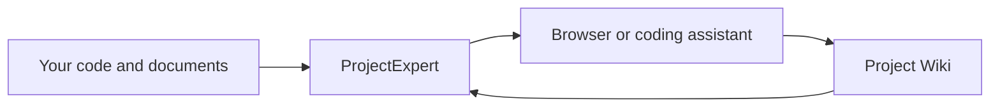

# README blueprint

This is an editorial specification and copy scaffold for the implementation agent, not a replacement for the current README. Validate commands in clean fixtures before publishing. Describe current capabilities only; add new research capabilities after their acceptance checks pass.

## Page order and writing constraints

Aim for 600–900 words excluding commands and tables. Put the preferred quick start within the first 40 lines. Use short sentences, familiar terms and descriptive links. Explain “dependency” once as “a library your project uses.” Use one small diagram on the home page, tables for parallel choices, and no module tree or historical phase table. Keep essential setup visible; use `<details>` only for secondary platform variations. Expanded pages own details, rather than duplicating the same paragraphs.

1. **What it is** — two plain-language sentences.
2. **Start with Docker** — prerequisites, working directory, one setup command, one run command, expected URL/readiness and stop command.
3. **No Docker? Use Python** — a compact expandable fallback with a link to the full guide.
4. **What can I do?** — outcome → interface → example question.
5. **Connect your tools** — URLs, ports and conditions, with one guide link.
6. **Capabilities and limits** — concise current support matrix.
7. **Configuration** — where to edit settings, key choices and how to restart.
8. **Learn more** — architecture, dependency research, troubleshooting and contributor links.

Suggested opening:

> ProjectExpert helps you understand a codebase and the libraries it uses. Run it beside your project, then ask questions in the browser or connect your coding assistant. Useful findings can be saved in a project Wiki for the next session.

Suggested home-page diagram:



Text alternative: ProjectExpert reads your project, supplies context to people and agents, and reuses curated Wiki explanations.

## Container quick-start copy scaffold

Prerequisites: Docker with Compose, access to the image registry, enough disk space for images/model assets, and a supported host. State the actually tested platform matrix and first-start download expectation. Do not require host Python or GNU Make for this path. Run from the repository the user wants to analyze, not the ProjectExpert implementation checkout.

**1. Set up** — exports the deployment kit into this project:

```bash
docker run --pull=always --rm -v "$PWD:/deployment" ghcr.io/shkirmantsev/project-intelligence-deployment:dev
```

**2. Run** — starts the service and prepares its model:

```bash
bash .project-intelligence-deploy/start.sh
```

Then open `http://localhost:8765/` (or the configured port). Check `http://localhost:8765/health/ready` if startup is still preparing data. Explain first-run readiness and link diagnostics. Use the kit's stop script or explicit `make -C .project-intelligence-deploy platform-stop` when Make is installed. Show `make -C .project-intelligence-deploy` as command discovery only after help-first ships.

Windows PowerShell uses the same setup image with `-v "${PWD}:/deployment"`, then `& .\.project-intelligence-deploy\start.ps1`. Keep that alternative in a short expanded block. Test it on Windows or label it NOT RUN; do not infer physical GPU success from script tests.

The `:dev` tag is a development channel, not a promise of a stable release. Confirm available release channels before calling one stable. Link existing upgrade instructions: exporting preserves files/image pins, so fetching a newer kit alone does not upgrade a pre-existing installation. Do not promise “latest” when retained pins point elsewhere.

## Python fallback scaffold

Run setup in a ProjectExpert source checkout. The analyzed repository is passed separately via `--target`. Document Python version and host restrictions from current packaging. Linux x86_64 currently has locked production requirements; other hosts need the documented, less strictly locked fallback and verification.

```bash
python3 -m venv .venv
.venv/bin/python -m pip install --require-hashes -r requirements-production-linux-x86_64.txt -r requirements-production-java-linux-x86_64.txt
.venv/bin/python -m pip install --no-deps '.[production]'
.venv/bin/python -m pip check
```

Run separately:

```bash
.venv/bin/python -m pi_platform.cli start --target /absolute/path/to/your-project --model gemma-torch --device cpu --serve
```

These are existing documented commands to verify, not a new setup script proposal. Keep Docker's two-command promise specific to the Docker path. Explain source checkout acquisition, native model download/access prerequisites, stopping the foreground server, and Windows interpreter path in the expanded install guide.

## Use cases and connections

| What I want | How I use it | Example |
|---|---|---|
| Understand an unfamiliar project | Built-in web UI | “Where is order validation implemented?” |
| Give a coding assistant project context | MCP client connected to ProjectExpert | Search requirements, source and curated explanations |
| Investigate a library | Dependency research tools after they ship | “Why is this version used, and what does this method do?” |
| Reuse an explanation next time | Wiki tools | Add a cited finding to the existing topic page |
| Use a separate chat frontend | Optional Open WebUI integration | Configure its backend against the enabled compatibility route |
| Request research from another agent | Optional A2A after research dispatch ships | Send the documented dependency task envelope |

Connection guide baseline to verify against the shipped startup composition:

| Surface | Address/port | Conditions |
|---|---|---|
| Built-in HTML UI | `http://localhost:8765/` | Default production service; honor PI_CONTROL_PORT override |
| REST | `http://localhost:8765/api/v1/` | Document authentication and supported operations |
| MCP HTTP | `http://localhost:8765/mcp` | Configure an MCP-capable client; distinguish from the harness project-context MCP |
| Health | `/health`, `/health/ready` on the product port | Distinguish live process from usable index |
| Embedded A2A | `/a2a/v1/tasks:send`, `/.well-known/agent-card.json` on the product port | PI_A2A_INBOUND and authorization; verify card route and advertised skills |
| Standalone A2A | CLI `a2a-serve`, default port 8766 | Separate optional process, not needed alongside embedded A2A |
| Open WebUI compatibility | `/v1/` only on a server configured with the shim | Optional frontend installed separately; verify flags, token and actual composition. A code constant uses port 8767, which is not proof of a default listener |
| Embedding service | Internal service port 8769 | Not the user chat/UI URL; do not publish as a browser interface |

Resolve the Open WebUI route/composition uncertainty before publishing a runnable example. From another container, `localhost` refers to that container; document the tested network/service address rather than blindly copying host URLs. Never say Open WebUI is included merely because a compatibility shim exists.

## Configuration and expanded-page ownership

For container users, point to `.project-intelligence-deploy/deployment.env`. Show verified options such as `PI_CONTROL_PORT`, `PI_ACCELERATOR` and `PI_EMBEDDING_MODEL`, their defaults and when restart is required. Explain target mount and data folders simply. Link advanced auth, model, policy, retrieval and new research-budget settings; do not invent environment variable names. Keep credentials out of examples.

| Page | Owns |
|---|---|
| `docs/PRODUCTION_INSTALL.md` | Full prerequisites, platform matrix, setup, venv, upgrades, model assets and rollback |
| `distribution/deployment/README.md` | Exported kit command reference and operations |
| `docs/USER_GUIDE.md` (new) | Use cases, interface setup, ports/auth and practical first queries |
| `docs/DEPENDENCY_RESEARCH.md` (new) | Language/lock support, source/decompilation limits, examples and Wiki reuse |
| `docs/CONFIGURATION.md` | Supported settings, defaults, precedence, restart/reindex effects |
| `docs/ARCHITECTURE.md` (new) | Big-picture architecture, user workflow and data process |
| `docs/TROUBLESHOOTING.md` | Readiness, actual orphan diagnosis, permissions, ports and missing evidence |
| `docs/HARNESS_COMMANDS.md` | Contributor/development harness; not the default product install path |

The architecture page must have three focused diagrams, each with prose: (1) user/agent interfaces → application services → language adapters/storage; (2) user question → retrieve existing knowledge → inspect missing evidence → cited answer → curate; (3) repository/artifacts → parse/chunk/enrich → derived index → retrieval, with curated Wiki and materialisation approval shown as separate write paths. Explain canonical versus disposable data in plain language. Link Wiki details instead of copying a full module inventory.
