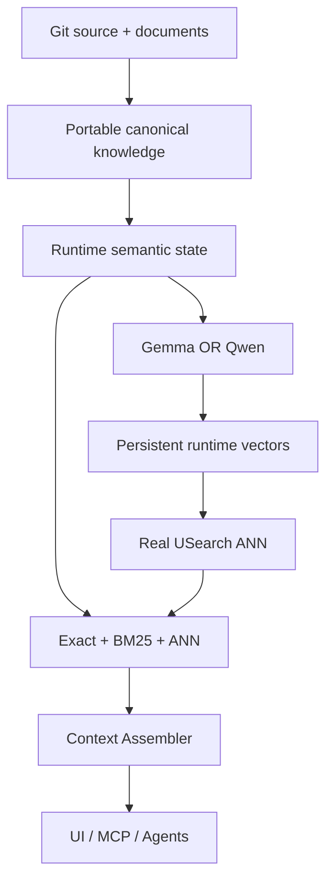
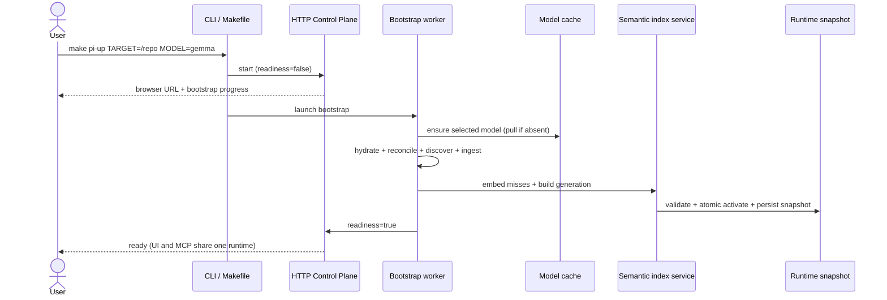
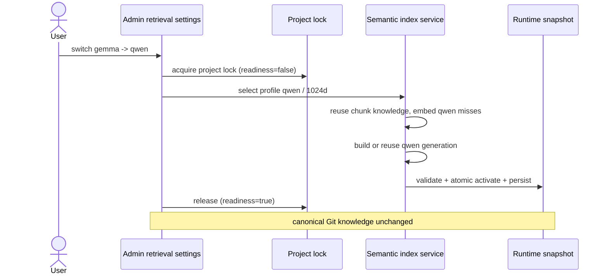
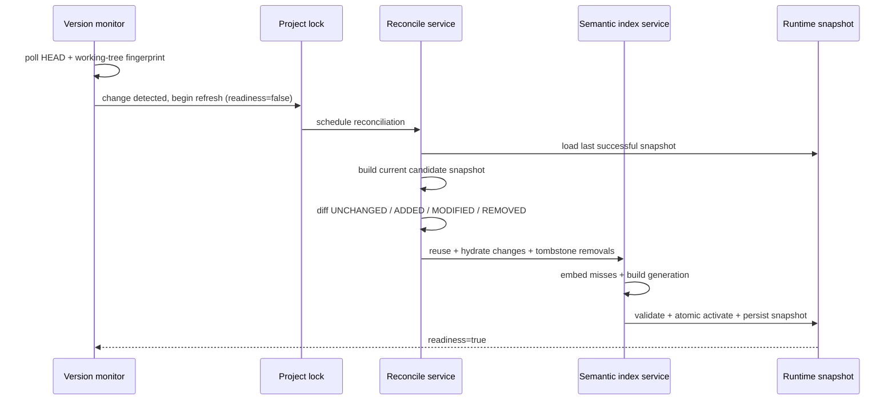

# Design — production-semantic-search-and-branch-reconciliation

Technical design for plan §79 PR1–PR12 under the plan §102 principle.
Behavioural requirements live in `specs/`; this file records the
architecture, module layout, data model, concurrency model, sequences
and failure modes that satisfy them.

## Current state

Verified in the working tree (2026-10-19; the plan's audited commit
`bc9be6e4` is absent from this clone, see `proposal.md`):

- `pi_platform/ports/retrieval/embedding_model.py` — `EmbeddingModelPort`
  with a text-only `embed` / `embed_batch` surface; no query/document role.
- `pi_platform/ports/retrieval/embedding_profile.py` — `EmbeddingProfile`
  with `EmbeddingProfile.identity()` and `EmbeddingProfileRegistry`;
  `EMBEDDINGGEMMA2_512`, `QWEN3_EMBEDDING_0_6B_1024`,
  `MULTIMODAL_FIGURE_512` still carry `model_revision="pinned-stub"`.
- `pi_platform/adapters/retrieval/embeddinggemma2_embedding_model.py` and
  `pi_platform/adapters/retrieval/qwen3_embedding_model.py` raise
  "not bound in this build".
- `pi_platform/adapters/retrieval/hashing_embedding_model.py` is the de
  facto default in some composition paths.
- `pi_platform/ports/runtime/dense_index.py` — `DenseIndexPort`;
  `pi_platform/adapters/runtime/usearch_dense_index.py` reports
  `usearch-stub` and delegates to `pi_platform/adapters/runtime/flat_dense_index.py`.
- `pi_platform/ports/runtime/vector_record_store.py` —
  `VectorRecordStorePort` / `VectorRecord` with
  `pi_platform/adapters/runtime/sqlite_vector_record_store.py` already
  persisting vectors as BLOBs.
- `pi_platform/ports/__init__.py` — `ReconcilePort`,
  `KnowledgeReadinessPort`, `RuntimeNotReadyError`,
  `WorkingTreeOverlayPort`, `VersionIdentityPort`;
  `pi_platform/core/sync/reconcile.py` (`ReconcileService`) accepts
  `previous_head` / `current_head` but scans only current manifests
  (plan §31); `pi_platform/core/sync/readiness.py`,
  `pi_platform/core/sync/project_lock.py`, `pi_platform/core/sync/wal.py`
  already exist.
- `pi_platform/runtime/cache.py` — `RuntimeCache` /
  `RuntimeCacheEntry`; `RuntimeCachePort` is defined in
  `pi_platform/ports/ingest/pipeline_driver.py` (re-exported from
  `pi_platform/ports/__init__.py`).
- `pi_platform/adapters/ui/composition.py` and `pi_platform/mcp/context.py`
  build retrieval stacks separately; the UI path hashes the corpus at
  query time (plan §27).
- `pi_platform/adapters/pdf/docling_pdf_adapter.py` and
  `pi_platform/adapters/pdf/docling_chunker.py` are stubs.
- `pi_platform/cli/main.py` has status commands but no `start` /
  `models` group; no automatic repository source discovery exists under
  `pi_platform/core/ingest/` (only `local_source_inbox_scanner.py`).

## Architecture

No new abstraction layer (plan §98). The plan §102 topology becomes the
runtime topology:



Architectural decisions carried by this design:

1. **One configuration resolver.** All entry points (CLI flags,
   environment, local runtime settings, `project-context.yaml`,
   built-in defaults) feed one resolution chain with precedence
   CLI → environment → local settings → project-context.yaml → default
   (plan §19). The resolved value object drives every later composition.
2. **Role-aware embedding contract.** The embedding surface gains an
   explicit request carrying role (query/document), task
   (search / code retrieval / question answering), optional title and the
   profile instruction version. Model-specific prompt policy stays inside
   each adapter (plan §8); the pipeline never formats prompts itself.
3. **Truthful capability state.** Every component is
   real-and-available, real-and-not-installed or disabled. The production
   profile fails startup with an actionable error when a selected
   production dependency is missing; hashing fallback is forbidden there
   (plan §2.1).
4. **Persistent vector namespace per profile.** `VectorRecordStorePort`
   remains the authoritative embedding storage; the semantic index
   service looks up vectors before embedding and persists only misses.
   Namespace identity = `EmbeddingProfile.identity()` hash (plan §24–§26).
5. **Generation-based ANN identity.** An ANN generation is identified by
   a content hash over active chunk IDs + retrieval-text hashes +
   profile hash + index schema version, stored as
   `<generation>.usearch` + `<generation>.json` under
   `.project-intelligence-cache/indexes/<profile-hash>/`, built as
   `.tmp` then atomically renamed, then activated by updating
   `runtime-state/active-version.json` (plan §29, §30, §42).
6. **One retrieval composition root.** `build_production_retrieval_runtime`
   is the single constructor used by UI, MCP, CLI and evaluation, ending
   the semantic drift between surfaces (plan §27, §28).
7. **Snapshot-based reconciliation.** Reconciliation compares the last
   successfully served snapshot (persisted) against a freshly built
   candidate snapshot, classifies UNCHANGED / ADDED / MODIFIED / REMOVED,
   tombstones removals, and only then swaps generations (plan §32–§38).
8. **Working-tree awareness.** Project identity is
   (HEAD, working-tree fingerprint); HEAD-identical dirty trees trigger
   refresh (plan §39). A portable polling monitor detects switches while
   the server runs (plan §40).
9. **Model-independent canonical knowledge.** Docling output is mapped to
   the neutral document model at the adapter boundary; tokenizer-specific
   splits are runtime embedding projections linked back to canonical
   chunks (plan §47–§50). Switching models never rewrites Git knowledge.
10. **Release gates enforce the above.** The PR12 gate rejects stub
    markers, `pinned-stub` licence entries and missing real-component
    integration evidence (plan §64, §89, §90, §97).

## Module layout

Planned additions (plan §81), grouped by PR slice:

```text
PR1   pi_platform/core/config/runtime_configuration.py
      pi_platform/adapters/config/runtime_configuration_resolver.py
PR2   (port update) pi_platform/ports/retrieval/embedding_model.py
PR3   pi_platform/adapters/retrieval/embedding_model_factory.py
      pi_platform/adapters/retrieval/model_cache.py
PR4   (factory/adapter reuse from PR3)
PR5   pi_platform/core/retrieval/semantic_index_service.py
PR6   pi_platform/adapters/runtime/dense_key_store.py
PR7   (composition root in pi_platform/adapters/ui/composition.py
      and pi_platform/mcp/context.py, shared builder in
      pi_platform/core/retrieval/)
PR8   pi_platform/ports/git/version_snapshot.py
      pi_platform/core/sync/version_snapshot.py
      pi_platform/core/sync/version_monitor.py
      pi_platform/adapters/runtime/runtime_version_state.py
PR9   pi_platform/core/ingest/repository_source_discovery.py
PR10  (real binding in pi_platform/adapters/pdf/docling_pdf_adapter.py,
      pi_platform/adapters/pdf/docling_chunker.py)
PR11  pi_platform/core/control/retrieval_settings.py
      pi_platform/adapters/ui/retrieval_admin_routes.py
      pi_platform/cli/main.py (start / models groups)
PR12  (gates under tests/, CI workflow, distribution/licenses/)
```

Existing modules requiring major edits (plan §82):

```text
pi_platform/ports/retrieval/embedding_model.py
pi_platform/ports/retrieval/embedding_profile.py
pi_platform/adapters/retrieval/embeddinggemma2_embedding_model.py
pi_platform/adapters/retrieval/qwen3_embedding_model.py
pi_platform/adapters/retrieval/hashing_embedding_model.py
pi_platform/adapters/runtime/usearch_dense_index.py
pi_platform/adapters/runtime/dense_index_backend.py
pi_platform/adapters/runtime/sqlite_vector_record_store.py
pi_platform/adapters/ui/composition.py
pi_platform/mcp/context.py
pi_platform/core/sync/reconcile.py
pi_platform/core/sync/readiness.py
pi_platform/adapters/pdf/docling_pdf_adapter.py
pi_platform/adapters/pdf/docling_chunker.py
pi_platform/cli/main.py
pyproject.toml, Containerfile, docker-compose.yml, Makefile
distribution/licenses/model-licenses.json
distribution/licenses/dependency-inventory.json
```

Key existing types the slices build on: `EmbeddingModelPort`,
`EmbeddingProfile` and `EmbeddingProfileRegistry`
(`pi_platform/ports/retrieval/`), `DenseIndexPort`
(`pi_platform/ports/runtime/dense_index.py`), `VectorRecordStorePort` /
`VectorRecord` (`pi_platform/ports/runtime/vector_record_store.py`),
`ReconcilePort` / `KnowledgeReadinessPort` / `RuntimeNotReadyError`
(`pi_platform/ports/__init__.py`), `RuntimeCache` / `RuntimeCacheEntry`
(`pi_platform/runtime/cache.py`), `RuntimeCachePort`
(`pi_platform/ports/ingest/pipeline_driver.py`), `ProjectLock`
(`pi_platform/core/sync/project_lock.py`).

## Data model

All new state is runtime state under
`.project-intelligence-cache/` (Git-ignored) or the model cache volume.
Canonical Git knowledge schema is unchanged (plan §78).

1. **Embedding profile identity (unchanged mechanism, real content).**
   `EmbeddingProfile` fields `provider`, `model_id`, `model_revision`,
   `modality`, `output_dimension`, `normalization`,
   `instruction_profile` (the **profile instruction version**; a
   change to this value changes the profile identity and requires
   a separate vector namespace — no new field is added because
   `instruction_profile` already participates in the canonical
   identity hash), `tokenizer_id`, `strategy_version`; identity =
   SHA-256 over canonical JSON (sorted keys, no volatile data).
   `pinned-stub` revisions are replaced by immutable upstream
   revision hashes (plan §11, §53). The PR 2 spec delta
   (`specs/2026-10-18-embedding-port-query-document-roles`) keeps
   the same field; it only requires that callers declare role and
   task explicitly.
2. **Vector records.** Existing `VectorRecord`
   (`chunk_id`, `content_hash`, `embedding_profile_hash`,
   `model_revision`, `dimension`, `normalization`, vector BLOB,
   retrieval-text hash) stays authoritative. Reuse key =
   retrieval-text content hash + profile hash (plan §25).
3. **Dense index generation.**
   `source_generation = SHA-256(active chunk IDs + retrieval-text hashes
   + embedding profile hash + index schema version)`; artifacts
   `<generation>.usearch` + `<generation>.json` (metadata:
   `embedding_profile_hash`, `source_generation`, `vector_count`,
   `index_schema_version`) under
   `indexes/<embedding-profile-hash>/` (plan §29). String chunk IDs map to
   stable numeric keys through a persisted key store so save/load/view
   round-trips identifiers (plan §23).
4. **Runtime version state** (`runtime-state/`):
   `active-version.json` (repo id, head, branch,
   working-tree fingerprint, manifest/source snapshot hashes, embedding
   profile hash, active index generation, last successful refresh id),
   `manifest-snapshot.json` (last-served canonical inventory with content
   hashes), `source-snapshot.json` (discovered source inventory). Written
   only after successful reconciliation and activation (plan §32–§35).
5. **Local runtime settings** (`settings.json`): user's model, device,
   dense backend and document-processing preference. Never committed;
   `project-context.yaml` may constrain allowed/recommended profiles
   (plan §20).
6. **Incremental discovery state** (persisted per target): path, source
   family, content hash, parser version, last effective retrieval-text
   hash (plan §44).
7. **Model cache** (`HF_HOME`-style directory, default
   `/models/huggingface` in containers): downloaded weights keyed by
   model id + immutable revision (plan §14).
8. **Optional embedding segments.** If tokenizer differences require it,
   a runtime projection links segment → canonical chunk under one profile
   hash; canonical chunking stays model-independent (plan §50).

## Concurrency model

- **Project lock.** Only one reconciliation or index mutation may run per
  target project. `ProjectLock` (existing) plus a refresh-job identity
  serialise refreshes (plan §41).
- **Fail-closed readiness.** While a refresh runs, `KnowledgeReadinessPort`
  reports not-ready; MCP/UI retrieval returns a structured
  "refreshing" result or `RuntimeNotReadyError` / HTTP 503. Stale branch
  data MUST NOT be served (plan §41).
- **Atomic generation swap.** Index build writes
  `<generation>.usearch.tmp`, validates profile hash, dimension, expected
  vector count and sample queries, atomically renames, then updates
  `active-version.json`. A failed build leaves readiness false and does
  not mark the previous state current (plan §42).
- **Single-writer snapshots.** `active-version.json`, manifest and source
  snapshots are written by the refresh job only, after activation; readers
  see either the old complete snapshot or the new complete snapshot.
- **Portable version monitor.** `ProjectVersionMonitor` polls Git HEAD and
  the working-tree fingerprint every 2–5 seconds (no OS-specific file
  watchers as the primary mechanism) and schedules reconciliation on
  change (plan §40).
- **Embedding concurrency.** Batch embedding is parallel-safe inside one
  refresh job; vector writes to `VectorRecordStorePort` are idempotent on
  (chunk, profile hash) so retries do not duplicate rows (plan §24).
- **Model switch.** A model switch is a refresh with a different profile
  hash: it acquires the same project lock, builds/reuses that profile's
  namespace and generation, and swaps atomically. Canonical files are
  read-only during the switch (plan §2.4, §87).

## Sequence diagrams

First start (plan §16, §17, §99):



Model switch (plan §2.4, §30, §58, §87):



Branch switch while running (plan §36–§42, §88):



## Failure modes

Plan §74 behaviour, and the actions the slices must implement:

| Failure | Required behaviour |
| --- | --- |
| Model download fails | Startup fails with an actionable error naming the model and the pull command; no silent hashing fallback in `production`. |
| Selected production dependency not installed | Startup fails with the actionable message (e.g. run the documented `models pull` command); capability report shows real-and-not-installed. |
| ANN index corrupt / incompatible metadata | Rebuild the generation from stored vectors without re-embedding; never serve from a corrupt index. |
| Vector records invalid or missing | Re-embed only the misses; never mix profiles to "repair" counts. |
| Reconciliation fails | Readiness stays false; previous runtime state is not marked current; error is surfaced; retry through the refresh job. |
| One document fails in Docling | Isolate the failure to that source, record it, continue the run; the source is retried on the next refresh. |
| Refresh requested while another runs | Requests receive "refreshing" / 503 semantics; no stale branch data is served. |
| Model switch interrupted | The previous profile generation remains active; the half-built generation is discarded on next start. |

## Compatibility and migration

- Behavioural deltas are additive at the capability level; the modified
  accepted contracts and their reconciliation notes are recorded in
  `proposal.md`.
- Existing stored vectors survive; incompatible namespaces rebuild from
  the vector store. ANN artifacts are disposable derived state.
- `minimal` remains available for deterministic CI; the hashing backend
  is not deleted, only restricted.
- The plan's audited commit `bc9be6e4…` is not present in this clone;
  slices verify current state against the working tree at execution time.

## Risks and rollback

1. **Real-model runtime size.** CPU torch plus two model families grows
   the image and first-run time. Mitigation: production image ships
   software only, weights land in a persistent volume (plan §5, §14);
   `core` image stays for deterministic CI. Rollback: pin the previous
   image tag.
2. **Dependency/licence drift.** Upstream model revisions and Docling
   assets change. Mitigation: immutable revisions in
   `model-licenses.json`, SBOM verification in the PR12 gate (plan §53,
   §54). Rollback: revert to the last verified revision set.
3. **Reconciliation correctness.** The snapshot diff is the highest-risk
   logic; a wrong classification can hide or leak evidence. Mitigation:
   the plan §68 branch test matrix (A→B→A, dirty tree, removals,
   concurrent refresh) is mandatory before PR8 merges. Rollback: keep
   the previous runtime state file set (they are written only after
   successful activation).
4. **Numerical policy regressions.** float16 defaults or un-normalized
   truncation would silently degrade retrieval. Mitigation: the profile
   requirements fix float32/bfloat16 and post-truncation normalization;
   PR3/PR4 health checks assert dimension and normalization (plan §9.5,
   §9.6, §10.4).
5. **Composition drift.** Two constructors could reappear. Mitigation:
   PR12 end-to-end test asserts UI and MCP answer identically for the
   same query/config (plan §27, §72).